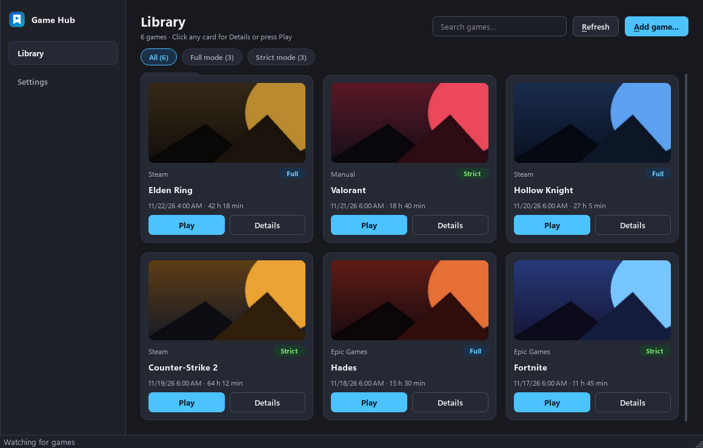
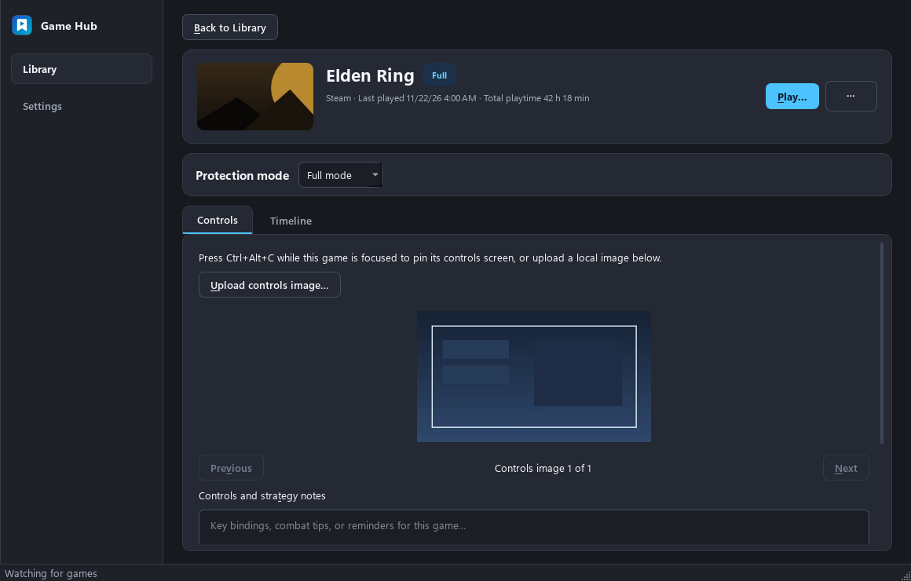
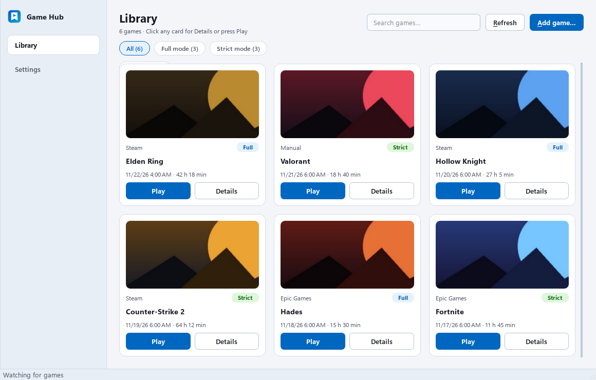
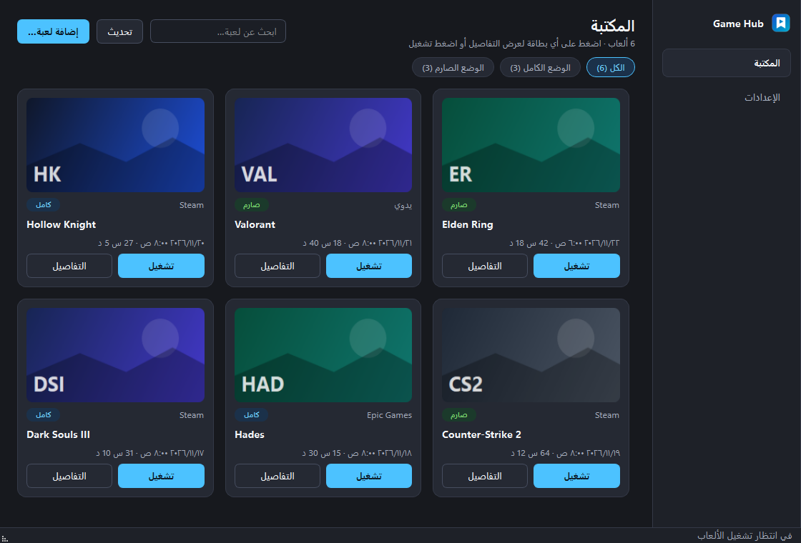
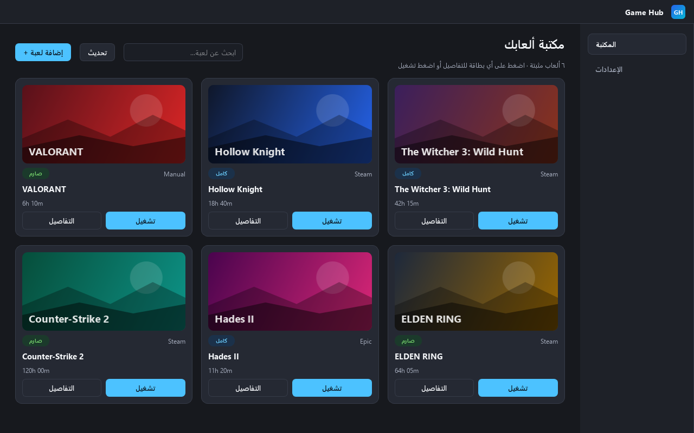

# Game Hub

Pick up any Windows PC game after a break with the voice/text notes, recent screenshots, playtime, and pinned controls you saved last time — **100% offline, zero background processes, and anti-cheat safe**.



| Game page | Light theme | Arabic RTL |
| --- | --- | --- |
|  |  |  |

## Features

- **Zero background footprint:** No system tray icon, no "start with Windows" registry entry, and no background services. Closing the main window exits Game Hub completely.
- **Anti-cheat safe by design:** Ships an updatable catalog (`gamehub/core/protection/protected_games.json`) of 38+ protected games (Valorant, League of Legends, Fortnite, Apex Legends, Call of Duty, Rainbow Six Siege, PUBG, Rust, EA SPORTS FC, CS2, Deadlock, Elden Ring, Armored Core VI, and more).
  - **Strict mode** (default for protected games): zero periodic screenshots, zero in-game hotkeys, zero topmost overlays, zero in-game mic access, and zero `OpenProcess` handles on protected games — just the Last-time card before launch and optional note after exit (or on next open).
  - **Forgetful-case safeguard:** If Game Hub is left open and you launch a protected game directly, passive basename-only detection exits Game Hub automatically by default (configurable to Strict mode or a passive Windows notification).
- **Local game library:** Auto-detects Steam, Epic Games Store, and supported Xbox/Game Pass installations, plus manual `.exe` add. [Launcher detection & limits](docs/launcher-detection.md)
- **"Last time" memory card & Play-through flow:** Click **Play** to review your last voice note (with optional auto-play), latest text note, last-moments screenshot carousel, playtime, and pinned controls before launching. Game Hub minimizes during play and offers a quick voice/text note prompt when the game closes.
- **Foreground-only screenshots (Full mode):** Captures only the verified foreground game window via Windows Graphics Capture (`draw_border=False` on supported Windows 11 builds) into a configurable ring buffer (default 10 shots, every 30 s).
- **Controls card & Session timeline:** Pin controls screenshots (`Ctrl+Alt+C` in Full mode or local image upload), write strategy reminders, and browse every past session chronologically.
- **Bilingual English & Arabic (RTL):** Switch languages live in **Settings** with full right-to-left mirroring.

## Download and install

Requires **Windows 10 (version 1809+)** or **Windows 11** on 64-bit (x64). No Python installation is needed.

1. Open [GitHub Releases](https://github.com/adhamelgohary-dev/game-hub/releases) and select the latest `vX.Y.Z` release.
2. Download **`GameHub-Setup-vX.Y.Z.exe`** from **Assets** (and optionally verify its hash in `SHA256SUMS.txt`).
3. Double-click the installer (per-user install, no administrator privileges required), then launch **Game Hub** from the Start menu.

For a portable install, download **`GameHub-Portable-vX.Y.Z.zip`**, extract the entire folder, and run **`GameHub.exe`** (keep `_internal` alongside it).

Upgrading over v1.0 automatically removes the legacy Windows startup (`Run`) entry while preserving all your data in `%LOCALAPPDATA%\GameHub\`.

## Default shortcuts (Full mode only)

| Shortcut | Action |
| --- | --- |
| `Ctrl+Alt+N` | Start or stop a 60-second voice note for the focused tracked game |
| `Ctrl+Alt+L` | Reopen the Last time card |
| `Ctrl+Alt+C` | Pin a controls screenshot of the focused tracked game |

*(All global shortcuts are customizable or can be cleared in **Settings**, and are automatically unregistered while any Strict-mode game is active.)*

## Privacy & security

- **100% offline** in v1.x: zero network calls, zero accounts, zero telemetry.
- **Zero injection or memory access:** never injects DLLs, hooks games, reads/writes game memory, or opens debug/write handles.
- See [SECURITY.md](SECURITY.md) for our vulnerability policy and SignPath Foundation code signing policy, and [docs/research/anti-cheat.md](docs/research/anti-cheat.md) for our cited anti-cheat analysis.

## Run from source (for developers)

Install Python 3.12 (x64) on Windows, then run in PowerShell from the repository root:

```powershell
py -3.12 -m venv .venv
.\.venv\Scripts\python.exe -m pip install -r requirements.txt -r requirements-dev.txt
.\.venv\Scripts\python.exe -m gamehub.app
.\.venv\Scripts\python.exe -m pytest -q
.\.venv\Scripts\python.exe -m ruff check .
```

## Folder structure

```text
gamehub/                       Windows desktop application
  core/                        Shared library, protection, sessions, capture, audio, hotkeys, i18n, storage
    protection/                Bundled protected_games.json catalog & LifecycleCoordinator
    notifications/             Passive Windows notification adapter (no tray / no topmost popups)
    library/                   Steam, Epic, Xbox detectors & validated launcher dispatch
    sessions/                  Passive Toolhelp basename & exact-path session tracking
    capture/                   Foreground-only WGC (draw_border=False on supported builds)
    audio/                     Local 60s Ogg Vorbis recorder & Qt Multimedia playback
    hotkeys/                   Win32 RegisterHotKey manager with Strict-mode suspend/resume
    i18n/                      English & Arabic catalog with RTL mirroring
    storage/                   Versioned SQLite (schema v5), symlink-safe media & store relocation
  modules/
    memory/                    Last time card, note prompt, controls & timeline controllers
  ui/                          Main window, Library, Game page, Settings
tests/                         Automated pytest suite & synthetic launcher fixtures
docs/                          Design contracts, anti-cheat research, UI mockups, reviews & guides
packaging/                     PyInstaller spec, version info, app manifest, Inno Setup & third-party notices
.github/                       Templates & Windows CI / SemVer release workflow
```

## Tech stack

Python 3.12+, PySide6 (LGPLv3, custom Fluent QSS), SQLite, Windows Graphics Capture (`windows-capture`), Pillow, PortAudio (`sounddevice`), libsndfile (`soundfile`), psutil, vdf, pytest, Ruff, PyInstaller, Inno Setup 6, and GitHub Actions.

## Roadmap

- **v1.x** — Offline Game Memory, zero background, anti-cheat Strict mode, modern Fluent UI, public open-source release.
- **v2** — Replay clips and optional Google Drive backup.
- **v3** — Local voice transcription and note search.
- **Later** — Launch Doctor and Mods & Arabic Translations installer.

Read [docs/design/README.md](docs/design/README.md), [PROGRESS.md](PROGRESS.md), [HANDOFF.md](HANDOFF.md), or [CONTRIBUTING.md](CONTRIBUTING.md) to get involved.

---

## العربية

يساعدك **Game Hub** على العودة لأي لعبة بعد فترة انقطاع عن طريق عرض آخر ملاحظاتك الصوتية والنصية وآخر لقطات الشاشة وبطاقة أزرار التحكم قبل التشغيل — **بدون إنترنت، وبلا أي عمليات في الخلفية، وبأمان تام مع أنظمة مكافحة الغش**.



- **بلا خلفية:** لا توجد أيقونة في شريط المهام أو تشغيل تلقائي مع ويندوز؛ إغلاق النافذة يغلق البرنامج تماماً.
- **حماية لمكافحة الغش:** الألعاب المحمية مثل Valorant وFortnite وApex Legends وCall of Duty وCS2 تعمل افتراضياً بالوضع الصارم أو يغلق Game Hub نفسه تلقائياً عند تشغيلها.
- **التثبيت:** افتح صفحة [الإصدارات](https://github.com/adhamelgohary-dev/game-hub/releases) ونزّل `GameHub-Setup-vX.Y.Z.exe` وشغّله بنقرتين، ويمكنك تحويل الواجهة للعربية من **الإعدادات**.

اقرأ [دليل المستخدم الكامل بالعربية](docs/USER-GUIDE-AR.md).

## License

Licensed under the [MIT License](LICENSE). Third-party runtime notices are included in [packaging/THIRD_PARTY_NOTICES.txt](packaging/THIRD_PARTY_NOTICES.txt).
<!-- Free code signing provided by SignPath.io, certificate by SignPath Foundation (uncomment once approved) -->
