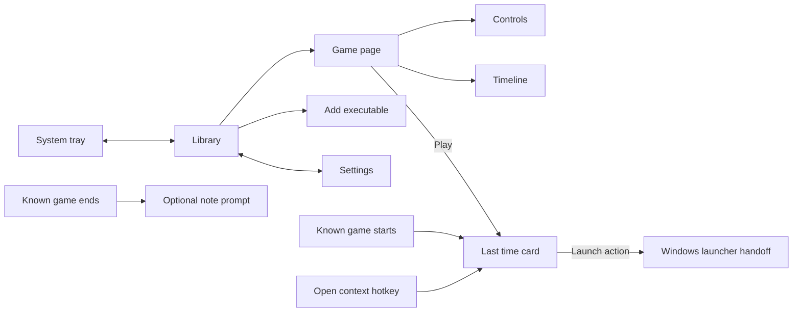

# User flows and screen layout

| Surface | Layout and primary actions |
| --- | --- |
| Library | Library and Settings navigation, Add game button, then game rows. Rows show local cover when available, game name, source, path, last played, and total playtime. Each row opens its game page. |
| Game page | Game name and Play, followed by Controls and Timeline sections. Each timeline item shows date, duration, and available screenshots and notes. |
| Last time | Game name, previous play summary, voice controls and optional text, last moments carousel, controls preview, and close. The Play entry adds the launch action. |
| Session note | Game name, voice recorder controls and timer, text editor, Save, and Dismiss. Expose the current recording and error states as accessible text. |
| Settings | Group language, capture, notes, hotkeys, startup, and data location. Show actionable errors adjacent to the affected setting. |
| Tray | Open Game Hub, tracking state when applicable, and Quit. Closing the library window leaves the app available in the tray. |

## R1 and R2 · Discover, track, and return

1. Open Game Hub. A second launch shows the existing window. Display the saved library promptly and refresh launcher detections in the background.
2. Select a game to open its page. If a game is missing, choose Add game, pick an `.exe`, confirm the displayed name and path, and save. The selection dialog can be cancelled. An unreadable or unsupported selection shows a recoverable error. An existing entry opens or is identified for the user.
3. Start a known game from its original launcher or from Game Hub. Once process tracking confirms it, the tray shows the running game and the app begins its session. Alt-Tab pauses capture while playtime tracking continues. When multiple games run, foreground actions follow the tracked window the user is using.
4. Close the game. Save end time, elapsed time, and retained captures, then refresh the timeline and totals and offer the configured note popup. After an interrupted app run, use the persisted recovery state and avoid an inflated duration. Missing detection inputs and inaccessible Xbox paths are reported as limitations, and other entries remain usable.

## R3 and R6 · Capture, pin, and browse

1. Keep a tracked game in the foreground. The capture interval begins after the game has an eligible window. Invalid, stale, protected, or black frames do not enter the ring. Returning from minimized or background state resumes capture on an eligible interval.
2. Press Ctrl+Alt+C (or the configured binding) while the game is focused to pin its current window. If capture is unavailable, show how to upload a local image from the Controls section. Decode and copy uploaded images to app-managed storage. Enter controls and strategy text on the same game page.
3. Open the Timeline and browse sessions, recent images, and each session's voice and text notes. New games show an empty state. Missing or unreadable media gets an item-level message with the rest of the timeline still accessible.

## R4 · Record or write a note

1. Press Ctrl+Alt+N (or the configured binding) with a tracked window focused. The recorder starts for that session and indicates elapsed time. Press it again to stop, or let the 60-second limit stop it. A focus switch never retargets the active recording. If the game ends during recording, finalize it for that session.
2. After a game closes, the optional popup identifies the game and binds to the ended session. Select voice, enter text, or dismiss. Save confirms when the note reaches storage. Microphone errors allow text entry, and a failed save leaves the draft available for retry or dismissal.
3. If a second game ends while the first popup is open, let the current note complete and then present the next prompt for its own session. An unavailable hotkey or microphone gets a specific, translated message and a path to Settings or text entry.

## R5 · View Last time and launch

1. Start a known game through any supported launcher. Show context for that game from prior ended sessions, including interrupted sessions with their status. Use the most recent available note of each kind independently. If there is no past play or media, display helpful empty states. Autoplay starts at most once for the automatic presentation, honors the setting, and exposes stop and replay controls.
2. Press Ctrl+Alt+L (or the configured binding) to reopen context. Prefer the focused tracked game, then an unambiguous tracked game, then a game explicitly selected in the app. If no game can be resolved, open the library for selection. For exclusive fullscreen, switch out to view the card or use Play from the game page before entering fullscreen.
3. On a game page, select Play. Present the card before the user chooses Launch. Dispatch the configured Steam URI, Epic URI, or executable through Windows. If the handoff fails, keep the card open and explain the failure. When Play leads to confirmed game startup, suppress a duplicate card and duplicate autoplay for the same launch.

## R7 and R9 · Adjust settings and navigate

1. Open Settings and edit language, capture interval, ring size, autoplay, close popup, bindings, startup, or data location. Show effective settings and recoverable errors. Keep the working binding when Windows rejects its replacement. Present and open the data folder, and guide any configured location change through a validated storage operation.
2. Switch Arabic and confirm translated content and mirrored layout in the Library, Game page, Last time, note popup, Settings, and tray. Preserve legibility of file paths, game titles, explicit key chords, and numbers inside Arabic layouts.
3. Use Tab, Shift+Tab, Enter, Space, and Escape where expected. Provide accessible names on controls and carousel actions, visible focus, readable contrast, and text alongside status icons. Keep automated startup cards and tray updates from unnecessarily interrupting keyboard input. Support scrolling and allow long translated labels to wrap at high DPI.
