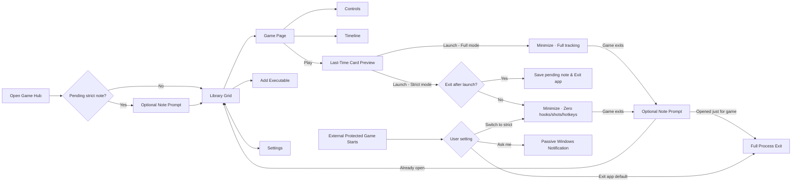

# User flows and screen layout (v1.1)

| Surface | Layout and primary actions (v1.1 Fluent UI) |
| --- | --- |
| **Navigation Shell** | Clean persistent left sidebar (mirrored to right in Arabic RTL) with app logo, **Library**, and **Settings** — no background-status pills or anti-cheat callout boxes cluttering the main chrome (those live under **Settings → About & Privacy**). |
| **Library** | Header with search bar, **Refresh**, and **Add Game** button, plus mode filter chips (`All` / `Full` / `Strict`). Responsive cover-art card grid loading real local Steam (`appcache/librarycache`) and Epic cover images with stylized placeholders only as fallback. Clicking anywhere on a card opens the Game page; each card has **Play** (primary) and **Details** (secondary) actions plus source and protection badges. |
| **Game page** | Hero banner with cover art, title, source, playtime summary, **Play** as the sole primary action, and a `"⋯"` overflow menu housing **Change executable…** and **Last moments…**. Below: **Protection Mode** selector (`Auto (Strict/Full)`, `Strict`, `Full`) + optional **"Exit Game Hub after launching"** toggle (for Strict mode), followed by **Controls** and **Session Timeline**. |
| **Last-time card** | Clean pre-launch modal/card: game cover + title, prior play summary, latest voice note player (autoplay toggle, play/stop/replay), latest text note, proper **"Last moments"** screenshot carousel (prev/next arrows + pagination dots, zero technical labels), controls preview, optional **"Exit Game Hub after this game closes"** checkbox, and primary **Launch Game** button. |
| **Note prompt** | Shown after game exit (or on next open for deferred Strict-mode launches): game header, 60-second voice recorder with live timer, text note editor, **Save**, and **Dismiss**. Accessible live status for mic errors with seamless text fallback. |
| **Settings** | Card-based grouped settings: **Appearance & Language** (English/Arabic, Dark/Light/System theme), **Anti-Cheat Protection** (External protected-game behavior: Exit automatically / Switch to strict mode / Ask via Windows notification), **Screenshots & Notes** (interval, ring size, autoplay voice, post-game prompt), **Global Shortcuts** (Full mode only), **Data Folder** (open/move), and **About & Privacy** (zero-background lifecycle and anti-cheat safety summary). No "Start with Windows" setting. |

## Primary v1.1 Flows

### 1. Play through Game Hub (Recommended path)
1. User opens Game Hub and clicks **Play** on a game card or Game page (or launches via `GameHub.exe --play <game_id>`).
2. Game Hub displays the **Last-time card** with previous notes, screenshots, and controls.
3. User clicks **Launch Game**.
4. **If Strict mode with "Exit after launch" enabled:** Game Hub dispatches the launch, writes a `pending_notes` record, and exits completely so zero Game Hub processes run during gameplay. Next time Game Hub opens (after the game is closed), it offers the Note prompt.
5. **If Strict mode (stay minimized):** Game Hub dispatches the launch, unregisters global hotkeys, pauses screenshot capture, suppresses in-game overlays, minimizes to the taskbar, and passively waits via basename-only Toolhelp polling (zero `OpenProcess` handles on the game) until the game exits.
6. **If Full mode:** Game Hub dispatches the launch, minimizes to the taskbar, and tracks the session with foreground-only borderless WGC screenshots and configured global hotkeys.
7. When the game exits, Game Hub restores (if configured for note prompt), shows the optional **Note prompt** (voice or text), and once saved or dismissed:
   - If opened just for this game (`--play` or "Exit after game closes" checked), Game Hub exits completely.
   - Otherwise, returns to the Library / Game page.

### 2. Forgetful case (External launch of a protected game while Game Hub is open)
1. User leaves Game Hub open in the library and launches a protected game (e.g., *Valorant*, *Fortnite*, *Apex Legends*, *Call of Duty*, *CS2*) directly from Riot/Epic/Steam/Battle.net.
2. Within 3 seconds, the passive basename-only scan notices the protected executable name without opening any handle to the game process.
3. Game Hub immediately executes the configured `protection.external_behavior`:
   - **`exit_app` (default):** Closes cleanly and exits the process immediately with zero popups over the game.
   - **`strict_mode`:** Unregisters global hotkeys, pauses capture, suppresses any topmost card, minimizes Game Hub, and shows an in-window strict-mode banner when next viewed.
   - **`ask_me`:** Disables hotkeys/capture immediately as a precaution and sends a standard passive Windows notification ("Protected game detected — Exit Game Hub or keep Strict mode?"). Never shows a topmost Qt window over the game.

### 3. Clean Exit (Zero Background)
1. User clicks the window close button (`X`) or presses `Alt+F4`.
2. Game Hub stops any active recording/playback, unregisters all hotkeys, stops capture and watcher threads, commits checkpoints, closes SQLite and the single-instance socket, and terminates the process completely. No tray icon remains and `Get-Process GameHub` returns nothing.

See [UI Mockups](mockups/index.html) for interactive Dark, Light, and Arabic RTL previews of all five screens.
