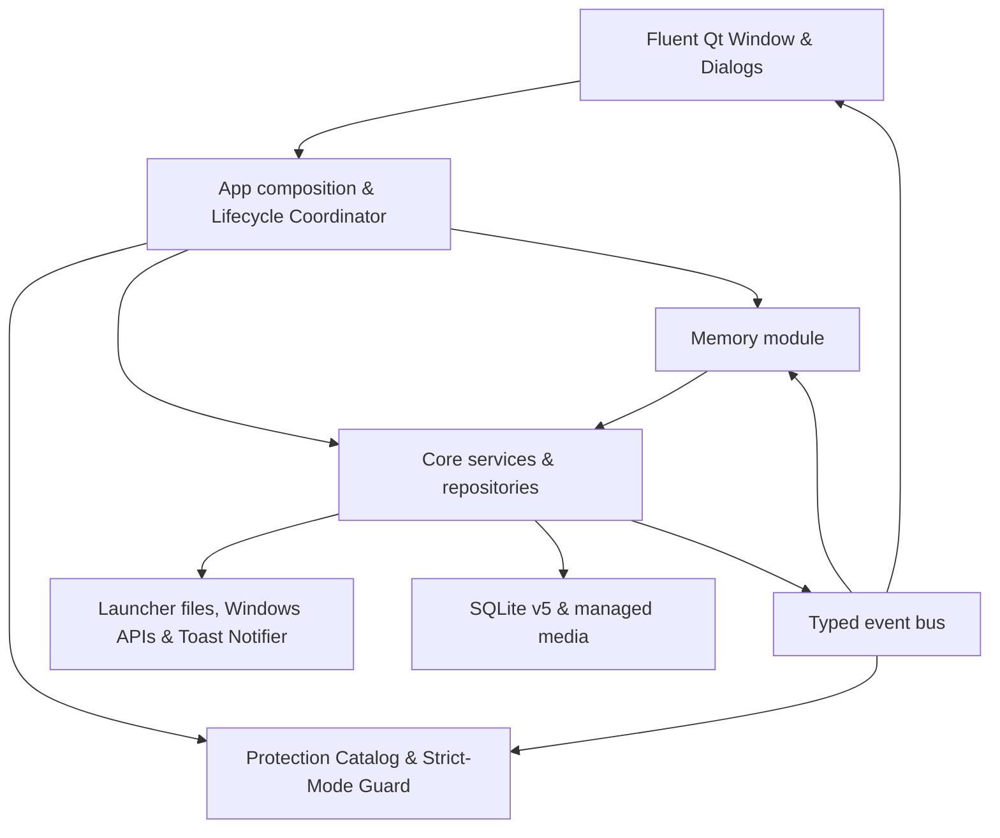

# Architecture (v1.1)

Game Hub is a single foreground-lifetime Windows desktop process with **zero background footprint**. `gamehub.app` is the composition root: it cleans up any legacy v1.0 `Run` startup key on first run, opens the local store (applying schema migrations), loads the bundled + optional override protected-games catalog, starts core services, registers the Memory module, and shows the main Qt window. Closing the main window cleanly shuts down every worker, unregisters all hotkeys, commits session checkpoints, and exits the process completely (`quitOnLastWindowClosed = True`).

| Location | Responsibility |
| --- | --- |
| `gamehub/app.py` | Foreground-only lifecycle, single-instance guard, `--play` flag, clean shutdown verification, legacy `Run` cleanup, dependency wiring |
| `gamehub/core/protection/` | `protected_games.json` catalog, `ProtectedGamesCatalog` (with local override support), per-game mode resolution (`strict`/`full`), and passive basename matching |
| `gamehub/core/library/` | Discover installed games (Steam, Epic, Xbox) + local cover art discovery, normalize identities, validate launch targets, manage manual entries |
| `gamehub/core/sessions/` | Passive basename-only detection for protected/strict games, exact-path matching for Full-mode games, session transitions, duration tracking |
| `gamehub/core/capture/` | Foreground eligibility gate, WGC `draw_border=False` on Windows builds >= 20348 (with fallback), frame validation, WebP encoding, bounded ring |
| `gamehub/core/audio/` | Bounded microphone recording (Ogg Vorbis) and Qt Multimedia local playback (disabled in-game during Strict mode) |
| `gamehub/core/hotkeys/` | Win32 `RegisterHotKey` manager with dynamic suspend/resume when entering/leaving Strict mode |
| `gamehub/core/notifications/` | Passive Windows toast/system notification adapter for the `ask_me` forgetful-case setting (never creates a topmost window over a game) |
| `gamehub/core/storage/` | Schema v5 migrations (`protection_mode`, `exit_after_launch`, `pending_notes`), serialized writes, safe media paths, integrity checks |
| `gamehub/core/settings.py` | Validated settings (`ui.theme`, `ui.language`, `protection.external_behavior`, capture, notes, hotkeys), live change notifications |
| `gamehub/core/i18n/` | English and Arabic catalogs, RTL layout mirroring, BiDi isolation for paths/shortcuts |
| `gamehub/modules/memory/` | Last-time card, end-of-session / pending note prompt, voice playback, controls, timeline |
| `gamehub/ui/` | Fluent QSS theme engine (Dark/Light/System), sidebar navigation, Library cover grid, Game page, Settings view, smooth transitions, vector icon |
| `packaging/` | PyInstaller spec (with version-info resource, app manifest, app icon), Inno Setup installer (deleting legacy v1.0 `Run` key), SignPath-ready workflow |

## Anti-Cheat Safety & Process Boundary Rules (Hard Invariants)

1. **Zero invasive APIs:** Game Hub never injects DLLs, hooks graphics/input (`SetWindowsHookEx`), reads/writes game memory (`ReadProcessMemory`/`WriteProcessMemory`), or opens handles with write, VM, or debug rights (`PROCESS_VM_*`, `PROCESS_ALL_ACCESS`, `SeDebugPrivilege`).
2. **Zero `OpenProcess` on protected/strict games:** `ProcessProbe` performs a single passive `CreateToolhelp32Snapshot(TH32CS_SNAPPROCESS, 0)` pass every 3 seconds.
   - Any process whose lowercase basename matches `ProtectedGamesCatalog` (or a game explicitly configured in Strict mode) is detected **purely by `szExeFile` basename**. `ProcessProbe` **never** calls `OpenProcess` or `psutil.Process(pid)` on that PID.
   - For Strict-mode games launched via Play without a manually assigned target executable, `SessionWatcher` passively tracks the union of the game's `game_targets` basenames and its matched `ProtectedGameEntry.exe_names` so game exit is still detected cleanly without opening any handle.
   - Only non-protected Full-mode target basenames proceed to `OpenProcess(PROCESS_QUERY_LIMITED_INFORMATION)` for exact path verification.
3. **Minimal logging:** Logs record only safe event codes, game IDs, and game names — never process lists, command lines, paths of unrelated apps, or user note contents.
4. **Strict mode runtime suspension:** Whenever any Strict-mode game is active (or a protected game triggers `strict_mode` or `ask_me` externally):
   - `GlobalHotkeys.suspend()` unregisters all three Win32 hotkeys immediately (even while awaiting an `ask_me` decision, so protection is instant).
   - `CaptureScheduler.pause()` stops periodic capture timers and rejects foreground capture requests.
   - `LastTimeController` suppresses automatic topmost card popups.
   - `NotesController` ignores hotkey recording and waits until the game exits before showing the Note prompt.
   - In `ask_me` mode, `WindowsNotifier` sends a passive OS toast notification (no tray icon, no topmost window over the game, no `powershell.exe` flash); if toast delivery is unavailable, Game Hub remains safely in Strict mode.
   - When the last Strict-mode game exits and Game Hub remains open, `GlobalHotkeys.resume()` and `CaptureScheduler.start()` restore Full-mode readiness cleanly.

## Foreground Capture (Borderless WGC)

In Full mode only, `WgcCapture` passes `draw_border=False` to `windows-capture` on Windows builds >= 20348 (Windows 11 / Server 2022+) to suppress the yellow capture border where Windows allows it. If the OS or driver rejects `draw_border=False` (e.g., older Windows 10 builds or policy restrictions), `WgcCapture` retries once with `draw_border=None` and caches the fallback for the remainder of the process lifetime so capture remains reliable without repeated failures.
