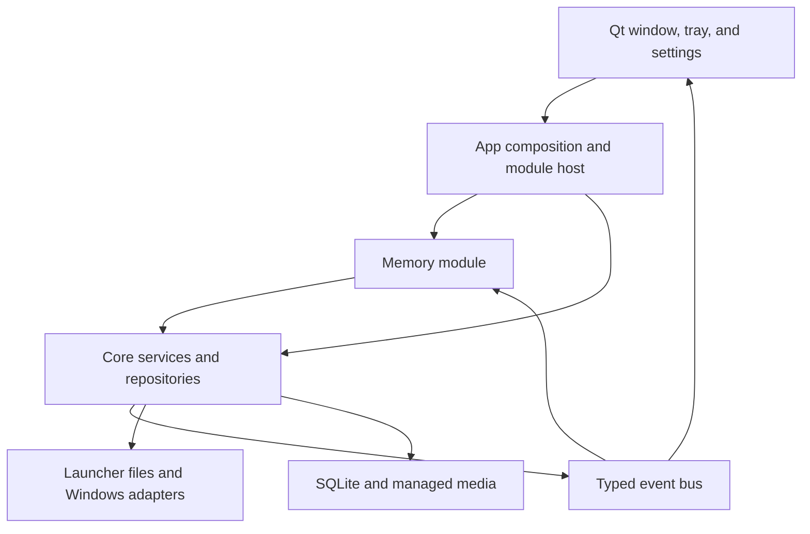
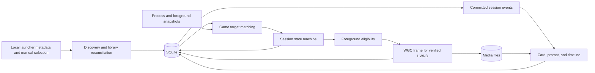

# Architecture

Game Hub is a single Windows desktop process. `gamehub.app` is the composition root. It opens the local store, creates platform adapters and repositories, starts the core services, registers the bundled Memory module, and shows the Qt window and tray. Closing the window hides it in the tray. Quit stops new work, drains bounded pending writes, closes still-running sessions as interrupted, and unregisters hotkeys.

| Location | Responsibility |
| --- | --- |
| `gamehub/app.py` | Lifecycle, single-instance guard, Qt setup, dependency wiring, bundled module registration |
| `gamehub/core/library/` | Discover installed games, normalize launcher identities, merge sightings, validate launch targets, manage manual entries |
| `gamehub/core/sessions/` | Match process identities, measure durations, commit session transitions, expose foreground game context |
| `gamehub/core/capture/` | Verify capture eligibility, bind the WGC window, accept one fresh frame, encode images, retain the session's latest captures |
| `gamehub/core/audio/` | Bound the microphone recording, encode the result, and play one local note at a time |
| `gamehub/core/hotkeys/` | Register action shortcuts using `RegisterHotKey`, route native messages through Qt, report conflicts |
| `gamehub/core/storage/` | Schema migrations, serialized writes, typed repositories, safe media paths, integrity checks, recovery |
| `gamehub/core/settings.py` | Validated settings, defaults, change notifications, and Windows startup setting coordination |
| `gamehub/core/events.py` | Typed local events and subscriber lifetime |
| `gamehub/core/i18n/` | English and Arabic catalogs, format keys, direction and locale selection |
| `gamehub/modules/memory/` | Last time card, end-of-session prompt, playback rules, timeline and controls |
| `gamehub/ui/` | Main window, library, game page, settings, reusable widgets and resources |
| `tests/` and `tests/fixtures/` | Deterministic service and parser tests and synthetic launcher data |
| `docs/design/` and `docs/reviews/` | Design contracts and milestone review records |
| `packaging/` and `.github/` | PyInstaller and Inno Setup definitions, CI and release configuration |

## Control flow and concurrency

The Qt thread owns widgets, native hotkey delivery, and event subscribers that update the UI. A single coordinator gives the SQLite writer and related media operations a predictable order. Launcher discovery, process polling, WGC callbacks, image encoding and audio recording run off the UI thread. Workers return immutable values through queued Qt signals or the coordinator. Event handlers enqueue costly operations and isolate failures so one subscriber cannot derail the rest. Use SQLite read connections per worker when necessary and short transactions so UI queries can use paginated snapshots.

## Discovery and session boundaries

Steam and Epic manifests establish installation identity. Track a Windows executable listed in trusted local launcher metadata when it resolves within that game's installation. For Steam installations without a reliable target, accept an unambiguous executable supported by the installation layout as a candidate after excluding known helpers, and leave other games discovered with tracking setup available. A manifest's launcher identity remains valid for Play when no process target is known. Test with installed Steam titles to verify automatic targeting where supported and assignment where needed. For Xbox, use readable XboxGames metadata and the current user's accessible installed game packages. Track only exact game application identities or verified executables. Report limited coverage where the data is absent or permission is denied.

Poll at 2–3 seconds with `psutil`, using executable basenames only to shortlist known path candidates. Match the normalized exact executable path or an exact package identity available through the Windows adapter. Avoid tracking launchers, updaters, and ambiguous matches. A user can resolve an ambiguous or missing target with an explicitly selected executable. Game Hub reads OS process metadata and does not request game memory or elevated permissions.

Identify each process instance by `(PID, creation time)` and group matched processes by game. The first observed live process opens a session. The last confirmed exit ends it. Several games can have open sessions independently. A transient scan failure or access denial is unknown, so it does not count as an exit. Repeated unknown samples suspend capture and eventually close the affected session as interrupted at its last confirmed checkpoint. A successful scan showing processed handles have exited can be debounced across one additional poll. Duration uses monotonic time while observation is reliable, with UTC for display. Persist a checkpoint on successful active polls. On recovery, close any abandoned active rows at their checkpoint. An observed game that is still running can begin a new session. Unobserved downtime adds no playtime.

M2 samples every three seconds. Two confirmed misses close a session as completed. Three consecutive uncertain samples close it as interrupted. Both use the last verified checkpoint. A confirmed reused PID with a different creation time opens a separate session when none of the previous identities remains live or uncertain. A Windows process inventory shortlists executable basenames, then reads only exact executable paths, creation times, or package identities. The watcher runs on its own worker and publishes committed transitions to Qt. It loads targets initially, then refreshes them after a committed library change. If a target disappears and the game has no other observed identity, close the session as interrupted.

M3 uses the Windows capture wheel's exact HWND and compositor QPC timestamp. A request expires after two seconds. The scheduler starts one request at a time, copies valid BGRA frames at the native callback, and checks focus and session identity again before retaining an encoded WebP. No native capture starts unless the foreground window matches a currently observed game. Native startup or stop that fails to return cannot start a second worker.

M4 uses one recording worker and the default Windows input stream. The recording binds the session at start and keeps that identity through encoding or a foreground change. Ctrl+Alt+N starts recording for the currently tracked foreground game and stops an active recording. A confirmed game exit saves an active hotkey recording to the original session and can then offer the optional note prompt. Closing the prompt cancels pending input and discards an unsubmitted recording. If storage fails after encoding, keep the bounded clip in memory for an explicit retry without reopening input. Qt and the tray show recording and error status.

M5 queries a single snapshot of completed and interrupted sessions for the Last time card. Qt decodes the chosen Ogg clip from a bounded memory buffer. A Play preview asks the user to launch after seeing the card. The launch attempt is consumed by the next observed start for that game within 90 seconds, which avoids a second card or repeat autoplay. A failed dispatch leaves the preview open. Ctrl+Alt+L resolves the focused tracked game, a single active game, or the last unambiguous card.

M6 upgrades SQLite to schema 4 with the `controls` table and adds paginated newest-first timeline queries to `MemoryRepository`. `Ctrl+Alt+C` reuses `CaptureService` through `CaptureScheduler`'s single capture worker so foreground pinning shares the exact HWND, active-session, freshness, and black-frame gates without overlapping periodic screenshots. Uploaded control images are read through bounded, symlink-safe storage, decoded within pixel limits, re-encoded to WebP without original metadata, and saved under `media/<game_id>/controls/control_<uuid>.webp`. The main window switches between the Library and a per-game Game page containing Play, Controls, and Timeline sections, and the Last time card displays pinned controls.

The Memory module uses the exact session ID from events and explicit UI actions. It prepares the Last time card from prior terminal sessions, excluding the current session. It loads the latest eligible voice and text note separately, labels them by date, and shows the latest terminal session's retained screenshots. The Play flow presents the card before dispatching the validated target to Windows. Correlate the local launch attempt with the next matching observed start so the same Play action does not show two cards or autoplay twice. The watcher remains the authority on actual starts, including starts made outside Game Hub.

## Foreground capture

Use Windows Graphics Capture through the `windows-capture` adapter and bind to the exact HWND. M3 verifies that the pinned Python wheel accepts `window_hwnd` and targets it end to end on supported Windows, including a frame timestamp suitable for rejecting buffered frames. At request time, resolve the current foreground top-level HWND, confirm it is visible and not minimized, match its owner PID and creation time to an active game session, and bind that verified HWND. Accept a fresh frame within a bounded timeout only if the same foreground HWND, process identity, session and capture generation still match. Recheck on focus loss, game exit and settings changes, and discard stale callbacks. Apply the same policy to the controls screenshot hotkey. An unsupported, blocked, or black frame produces no saved image. There is no screen, window-title, or cropped-desktop fallback. See [Microsoft's HWND capture contract](https://learn.microsoft.com/windows/win32/api/windows.graphics.capture.interop/nf-windows-graphics-capture-interop-igraphicscaptureiteminterop-createforwindow) and the [upstream WindowsCapture wrapper](https://github.com/NiiightmareXD/windows-capture/blob/main/windows-capture-python/windows_capture/__init__.py).

## Boundaries

Windows adapters cover OS calls, validated launcher dispatch, input devices and the startup setting. Tests substitute those adapters and clocks. Modules receive the event bus, repository interfaces and permitted service ports from the host. They own their workflows and contribute UI through host actions and views. They have no direct imports from sibling modules. v1 loads only its bundled Memory module and performs no application network requests.
