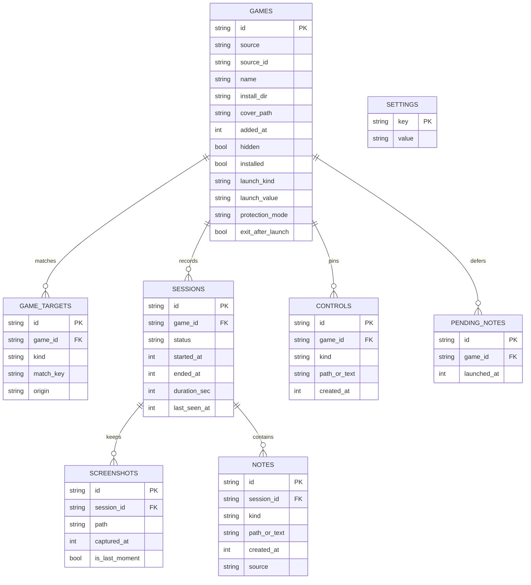

# Data model (v1.1 — Schema v5)

The default data root is `%LOCALAPPDATA%\GameHub\`. It contains `gamehub.db`, `media\`, `logs\gamehub.log`, and optionally `protected_games_override.json`. Treat the database and media as one store. Use SQLite with foreign keys enabled on every connection and a single writer. IDs are lowercase UUID strings generated by Game Hub. Timestamps are UTC epoch milliseconds stored as integers.



## Schema v5 Additions (Migrated from v4)

Upgrading an existing v1.0 (`user_version = 4`) database automatically creates `gamehub.db-v4.bak` beside the database before applying migration 5 inside a single atomic transaction:

1. `games.protection_mode TEXT NOT NULL DEFAULT 'auto' CHECK (protection_mode IN ('auto', 'strict', 'full'))`
   - `'auto'` delegates to `ProtectedGamesCatalog` (Strict for known protected games, Full otherwise).
   - `'strict'` or `'full'` stores the user's explicit per-game override from the Game page.
2. `games.exit_after_launch INTEGER NOT NULL DEFAULT 0 CHECK (exit_after_launch IN (0, 1))`
   - When enabled on a Strict-mode game, launching via Play records a `pending_notes` row and exits Game Hub immediately.
3. `pending_notes(id TEXT PRIMARY KEY NOT NULL, game_id TEXT NOT NULL REFERENCES games(id) ON DELETE RESTRICT, launched_at INTEGER NOT NULL) STRICT`
   - Indexed on `(launched_at DESC, id)`.
   - Consumed on the next Game Hub startup when the referenced game is not running: if the user saves a note, a completed session row (`started_at = launched_at`, `ended_at = now`, `duration_sec = 0`, `status = 'completed'`) is inserted so the note attaches cleanly to the game's timeline; if dismissed, the `pending_notes` row is deleted with no empty session created.
4. Legacy setting key `app.start_with_windows` is deleted during migration 5 (and ignored if encountered).

## Settings and File Formats (v1.1)

| Key | Type and default | Validation |
| --- | --- | --- |
| `ui.language` | string, `en` | `en` or `ar` |
| `ui.theme` | string, `dark` | `dark`, `light`, or `system` |
| `protection.external_behavior` | string, `exit_app` | `exit_app`, `strict_mode`, or `ask_me` |
| `capture.interval_sec` | integer, `30` | 5–300 seconds (Full mode only) |
| `capture.buffer_size` | integer, `10` | 1–50 images (Full mode only) |
| `memory.autoplay_voice` | boolean, `true` | Qt Multimedia playback uses the saved setting |
| `memory.prompt_on_end` | boolean, `true` | Applies after game exit / pending note launch |
| `hotkey.record_note` | string, `Ctrl+Alt+N` | Canonical supported key combination (Full mode only) |
| `hotkey.last_time` | string, `Ctrl+Alt+L` | Canonical supported key combination (Full mode only) |
| `hotkey.pin_controls` | string, `Ctrl+Alt+C` | Canonical supported key combination (Full mode only) |

*(Removed in v1.1: `app.start_with_windows`.)*

## Protected-Games Data File (`protected_games.json`)

Shipped as a pure data asset at `gamehub/core/protection/protected_games.json` and optionally extended/overridden by `%LOCALAPPDATA%\GameHub\protected_games_override.json`:

```json
{
  "schema_version": 1,
  "updated_at": "2026-11-23",
  "games": [
    {
      "id": "valorant",
      "name": "Valorant",
      "anti_cheat": "Riot Vanguard",
      "privilege": "kernel",
      "starts_at": "boot",
      "default_mode": "strict",
      "steam_app_ids": [],
      "epic_app_names": [],
      "xbox_package_prefixes": [],
      "exe_names": ["valorant-win64-shipping.exe", "valorant.exe"]
    }
  ]
}
```

Invalid or missing override files log a safe diagnostic warning and fall back cleanly to the bundled catalog.

## Existing Tables & Media Rules

All v1.0 tables (`games`, `game_targets`, `sessions`, `screenshots`, `notes`, `controls`, `settings`), managed media paths (`media/<game_id>/<session_id>/shot_<uuid>.webp`, `note_<uuid>.ogg`, `media/<game_id>/controls/control_<uuid>.webp`), symlink/reparse containment, `store-location.json` relocation, and startup reconciliation remain unchanged and backward-compatible with v1.0 user data.
