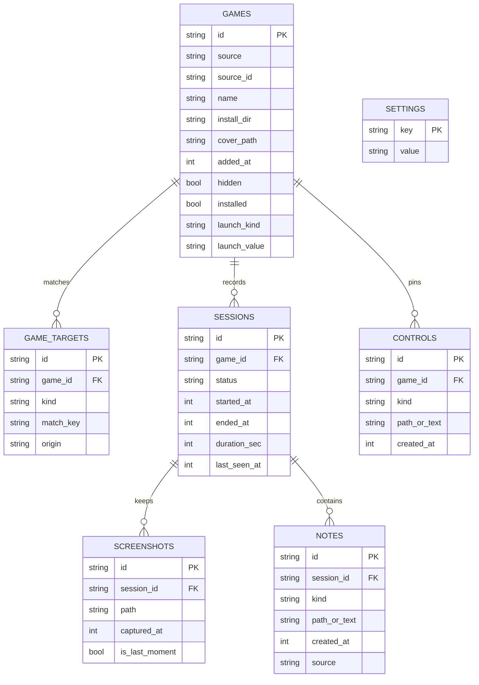

# Data model

The default data root is `%LOCALAPPDATA%\GameHub\`. It contains `gamehub.db`, `media\`, and `logs\gamehub.log`. Treat the database and media as one store. Use SQLite with foreign keys enabled on every connection and a single writer. IDs are lowercase UUID strings generated by Game Hub. Timestamps are UTC epoch milliseconds stored as integers. Durations are non-negative integer seconds measured with a monotonic clock. Display formatting belongs to the UI.

## Fields and constraints

All fields are required unless marked nullable. Use `TEXT` for IDs, paths and strings, and `INTEGER` for timestamps, counts and booleans. Boolean checks admit only 0 and 1. IDs are primary keys except in `settings`, where `key` is the primary key.

| Table | Fields and constraints |
| --- | --- |
| `games` | `id`, `name`, `source` (`steam`, `epic`, `xbox`, `manual`), `source_id`, `install_dir` (nullable absolute path), `cover_path` (nullable local absolute path), `added_at`, `hidden` (default false), `installed` (default true), nullable paired `launch_kind` (`steam_uri`, `epic_uri`, `exe`) and `launch_value` (validated URI or absolute executable). Unique `(source, source_id)`. Manual uses its own stable ID for `source_id`. |
| `game_targets` | `id`, `game_id` → `games.id`, `kind` (`exe_path`, `package_id`), `match_key` (normalized exact Windows path or exact package identity), `origin` (`discovery`, `manual`). Unique `(game_id, kind, match_key)` and at most one explicit manual owner per `(kind, match_key)`. Multiple games may claim the same detected match key. The explicit owner wins. Unresolved ambiguity is visible in Library and creates no session. |
| `sessions` | `id`, `game_id` → `games.id`, `started_at`, `ended_at` (null only while open), `last_seen_at`, `duration_sec` (starts at zero), `status` (`open`, `completed`, `interrupted`). Open sessions use `last_seen_at` and `duration_sec` as the last committed observation. On recovery, set `ended_at` to that checkpoint and mark interrupted. Enforce at most one open session per game. |
| `screenshots` | `id`, `session_id` → `sessions.id`, unique relative `path`, `captured_at`, `is_last_moment` (default false). Preserve capture order across wall-clock resets by clamping each newly stored timestamp to at least one millisecond after the preceding stored timestamp. A finalization transaction marks all retained rows as last moments. Sort any existing equal timestamps by ID. |
| `notes` | `id`, `session_id` → `sessions.id`, `kind` (`voice`, `text`), `path_or_text`, `created_at`, `source` (`popup`, `hotkey`). `path_or_text` holds a validated managed path for voice and nonblank text for text. The session join supplies `game_id`, so an ID cannot disagree with the owning game. |
| `controls` | `id`, `game_id` → `games.id`, `kind` (`image`, `text`), `path_or_text`, `created_at`. The same validation rule applies for image paths and text. |
| `settings` | `key`, `value` as a JSON scalar validated on read and write. An absent key uses the versioned application default. |

Foreign keys restrict parent deletion. v1 keeps historical games and sessions. A successful, complete detector scan can mark unseen games uninstalled by source, while a missing launcher, partial scan or parse error preserves its previous sightings. Keep user settings and history independently of detector changes. Resolve library launch and watch capabilities from the current game and its available targets.

Indexes cover `game_targets(kind, match_key)`, a partial unique `game_targets(kind, match_key)` where `origin = 'manual'`, `sessions(game_id, started_at DESC, id)`, a partial unique `sessions(game_id)` where `status = 'open'`, `screenshots(session_id, captured_at, id)`, `notes(session_id, kind, created_at DESC, id)`, and `controls(game_id, created_at, id)`. A manual add resolves normalized path and explicit owner in its write transaction. It returns an existing owner for repeats, including Windows spelling variants, before inserting a new game and target together. Query playtime from observed session durations, including interrupted sessions and the latest confirmed checkpoint of an active session. Resolve last played from the newest recorded start, and use the previous terminal session for the Last time card.

## Settings and file formats

| Key | Type and default | Validation |
| --- | --- | --- |
| `ui.language` | string, `en` | `en` or `ar` |
| `capture.interval_sec` | integer, `30` | 5–300 seconds |
| `capture.buffer_size` | integer, `10` | 1–50 images |
| `memory.autoplay_voice` | boolean, `true` | Qt Multimedia playback uses the saved setting |
| `memory.prompt_on_end` | boolean, `true` | Applies to normal game exits |
| `hotkey.record_note` | string, `Ctrl+Alt+N` | Canonical, supported key combination |
| `hotkey.last_time` | string, `Ctrl+Alt+L` | Canonical, supported key combination |
| `hotkey.pin_controls` | string, `Ctrl+Alt+C` | Canonical, supported key combination |
| `app.start_with_windows` | boolean, `false` | Coordinate with per-user Windows startup registration |

An empty shortcut disables its action. Reject duplicate nonempty shortcuts and resolve Windows registration conflicts before replacing a working shortcut. Invalid settings loaded from older or damaged storage fall back to the relevant defaults and report the affected key without logging its value. `store-location.json`, a versioned local bootstrap file in the default folder, stores `version: 1` and `data_root` only when a custom root is active. Settings shows the resolved root. No SQLite row depends on an absolute managed-media root.

Use `media/<game_id>/<session_id>/shot_<uuid>.webp`, `media/<game_id>/<session_id>/note_<uuid>.ogg`, and `media/<game_id>/controls/control_<uuid>.webp`. Each UUID is the owning row ID. The coordinator generates each canonical path from the owning game, session and row and accepts it only for its matching media kind. Disjoint path prefixes and row primary keys give each managed media path exactly one owner across screenshots, voice notes and control images. Verify the ownership rule when reconciling. Save screenshots and imported controls as WebP and record microphone clips as Ogg Vorbis. Import controls by decoding within size limits and re-encoding without original metadata. Media references are forward-slash relative paths stored in SQLite. Source install directories, executable paths and local cover paths are read-only references outside managed media.

## Media creation, pruning, and recovery

The coordinator validates each generated media path and opens a uniquely named temporary file under the target directory. It completes and flushes the file, atomically renames it on the same volume, then commits the reference. Failed commits leave either a removable temporary file or an unreferenced managed file. A screenshot append inserts the newest image and removes old row references in one transaction, then deletes the evicted files after commit. A buffer-size decrease applies to active sessions, leaving past sessions intact. Serialize accepts, finalization and pruning by session so late frames cannot reopen a closed buffer. A failed eviction unlink is retried through reconciliation.

Resolve and validate managed paths at operation time, rejecting traversal, rooted paths, alternate data streams, symlinks, junctions and other reparse points. Verify the actual destination remains within the resolved root for writes, renames and deletes. Use directory handles that prevent rename and read bounded screenshot bytes through a handle that checks the opened file's attributes before decoding. On startup, after opening and validating the database, reconcile only identifiers and filenames that match Game Hub's managed media layout. Remove abandoned temporary and unreferenced known files. Preserve rows for missing files and let the UI show an unavailable item. Preserve unexpected files for inspection. A storage error can disable writes or media capture without preventing access to intact data.

## Versions and folder changes

Track ordered migrations using SQLite `user_version`. Apply migrations before starting services and take a local SQLite-consistent backup before upgrading an existing store. Store the backup alongside the database as `gamehub.db-v1.bak` or `gamehub.db-v2.bak` for the schema opened by the upgrade. Set `user_version` inside the same transaction as its migration so schema and version commit together. A newer unsupported schema or failed integrity check opens a recovery screen and blocks writes. Exercise each older supported schema in migration tests, force a migration failure and reopen to verify both schema and version rolled back, and verify that IDs, media paths and history remain readable. Resolve per-format or bootstrap versions independently of database schema versions.

The M3 migration from schema 1 to 2 stores its pre-upgrade backup beside the database as `gamehub.db-v1.bak`. A fresh store creates all four tables in one transaction without needing a backup.

To move the data folder, require a fresh writable local destination under the user's control, pause new work and checkpoint open sessions. With the store closed to writers, copy a SQLite-consistent snapshot and referenced media to an isolated staging destination, verify schema and file inventory, and atomically replace the bootstrap pointer only after validation. A failed copy leaves the current store selected. Keep the previous copy after a successful switch so the user can verify the move. The next startup verifies the selected root before allowing writes. An unavailable selected root prompts recovery and avoids initializing a second silent store.
